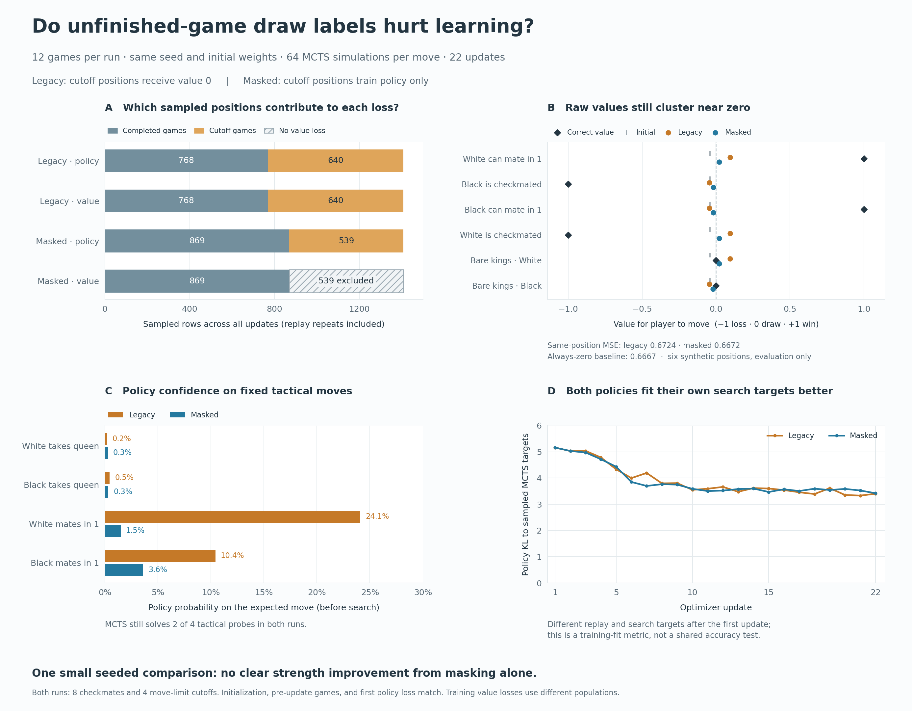

# Excluding unfinished games from value loss — November 6, 2026

This matched 12-game rerun does **not establish that cutoff draw labels were hurting learning**. Excluding them worked as intended, but both final models still predicted values close to zero and solved the same two of four tactical probes. The masked model's small improvement on six common value examples did not beat an always-zero predictor. More training and multiple seeds are needed to distinguish a useful effect from a single short trajectory.

## What changed

All positions from unfinished games remain available for policy training, using their MCTS visit targets. They are excluded from value loss. Genuine rule-defined draws still train value zero. Value MSE averages over the eligible rows in each batch; with no eligible rows, the value head receives no gradients and value measurements are unavailable. The shared trunk still learns from policy examples, which can indirectly change value predictions.

The control is the [previous recorded experiment](../2026-11-06-inspection-01/README.md), which assigned zero value targets to unfinished games. Every recorded training/search hyperparameter matches: fresh random initialization, seed 1, CPU/four threads, 128 channels, 12 games, 64 simulations per move, 200-ply limit, 256-position warmup, two Adam updates per game, batch size 64, learning rate 0.001. Probe and checkpoint schedules also match. We verified exact initial checkpoint tensors, identical initial probes, identical first two game histories, and identical first policy loss. After the first changed update, the games and sampled replay populations legitimately diverge.

Normalization is part of the intervention: averaging over eligible rows increases the weight of each completed-game row relative to the old full-batch mean. This experiment tests that complete change, not label removal at a fixed per-row value weight.

## Results

| Measurement | Cutoffs labeled draws | Cutoffs excluded from value |
|---|---:|---:|
| Checkmates / actual draws / cutoffs | 8 / 0 / 4 | 8 / 0 / 4 |
| Generated positions | 1,874 | 1,637 |
| Cutoff-origin positions retained for policy | 800 | 800 |
| Positions available for value training | 1,874 | 837 |
| Optimizer steps | 22 | 22 |
| Sampled policy rows, including replay repeats | 1,408 | 1,408 |
| Sampled value rows, including replay repeats | 1,408 | 869 |
| Sampled cutoff rows used by policy | 640 | 539 |
| Sampled cutoff rows used by value | 640 | **0** |
| Final MCTS tactical checks | 2 / 4 | 2 / 4 |
| Final policy KL on each run's own batch | 3.402 | 3.422 |
| Value MSE on the same six labeled examples | 0.6724 | 0.6672 |



The common value examples are White/Black mate-in-one positions (target +1), the resulting checkmated positions (target −1), and bare kings with each side to move (target 0). Values use the player-to-move perspective. Initial MSE was 0.6683; always predicting zero scores **0.6667**. These six synthetic examples include terminal positions that are handled directly by search and are absent as replay inputs; they diagnose the raw value head, not general playing strength. They are never added to training data.

The masked model's predictions were even closer to zero than the control's. On White/Black mate-in-one, the control predicted +0.094 / −0.046, versus +0.022 / −0.020 after masking. Thus, removing cutoff zeros did not by itself produce meaningful win/loss separation in this run. All eligible training labels in the masked run were ±1, because no real draws occurred.

The fixed raw policy results were mixed:

| Expected move(s) | Initial probability | Final draw-label control | Final value mask |
|---|---:|---:|---:|
| White mate in one | 4.37% | 24.09% | 1.49% |
| Black mate in one | 4.27% | 10.43% | 3.61% |
| White captures hanging queen | 7.33% | 0.21% | 0.28% |
| Black captures hanging queen | 7.77% | 0.45% | 0.32% |

Search still found both mates under both final models, despite the masked model's weaker policy probabilities for those moves. Both missed the two hanging-queen checks. The initial search passed three of four. This gives no evidence of stronger play after this short training run.

Training value losses are intentionally **not compared as accuracy measurements**: the control includes cutoff zeros, while the masked run measures only real outcomes. Policy KL also uses different self-play batches after the intervention, so its similar final values are descriptive, not a shared validation score. Cutoff frequency and game length likewise do not measure playing strength.

## Reproduce and inspect

Run the treatment in a fresh directory:

```bash
.venv/bin/python chess/scr/main.py \
  --iterations 12 --sims 64 --max-moves 200 --hidden 128 \
  --batch-size 64 --min-buffer 256 --updates 2 --seed 1 --device cpu --threads 4 \
  --run-dir runs/cutoff-value-mask-reproduction --trace-every 1 \
  --probe-every 4 --probe-sims 80 --save-every 4 --report-every 1 \
  --cutoff-value-policy exclude
```

Use `--cutoff-value-policy draw` and another fresh directory for the legacy control. Do not use `--resume`: the comparison starts both models from identical random initialization. Exact numerical reproduction depends on the device, Torch version, and thread settings recorded in `config.json`.

With both full local runs and checkpoints available:

```bash
PYTHONPATH=chess .venv/bin/python -m scr.compare_training \
  runs/2026-11-06-inspection-01 runs/2026-11-06-cutoff-value-mask-01 \
  --output /tmp/chess-cutoff-comparison.json
```

The comparator checks provenance, reports sample denominators, and evaluates both final models plus their shared initialization on the six labeled positions. `comparison.json` here preserves the observed results with repository-relative paths. Its successful checks describe the original local runs; weights are not included in this compact archive.

The full treatment is in `runs/2026-11-06-cutoff-value-mask-01/`: open `report.html` to inspect every position, value coverage, optimizer curves, and probes. That directory retains all traces, source snapshots, and checkpoints at games 0, 4, 8, and 12. The control remains in `runs/2026-11-06-inspection-01/`. Both are ignored by Git.

This archive includes portable config/summary files, move histories, all update/probe records, and the comparison. Detailed per-ply traces are omitted. Run `python3 experiments/2026-11-06-cutoff-value-mask-01/plot.py` with Matplotlib installed to regenerate the PNG/SVG. Plotting is optional; the engine and HTML report do not depend on it.

All 1,637 moves, trace FENs, legal-move counts, and final outcomes/ending reasons were independently verified against python-chess. Tests cover eligible-only loss and gradients, genuine draws, all-masked updates with existing Adam momentum, legacy control behavior, comparison provenance, and report coverage labels. Report controls were exercised with a JavaScript DOM test double.

## What this suggests next

Keep unknown outcomes separate from genuine draws, and retain the explicit control flag. To test the learning effect more convincingly, repeat both conditions across several seeds with a larger fixed evaluation set and longer training. A separate comparison using frozen self-play data would isolate the direct effect of value supervision from the later feedback through search and replay. This pilot supplies a reproducible starting point, not a verdict about playing strength.
