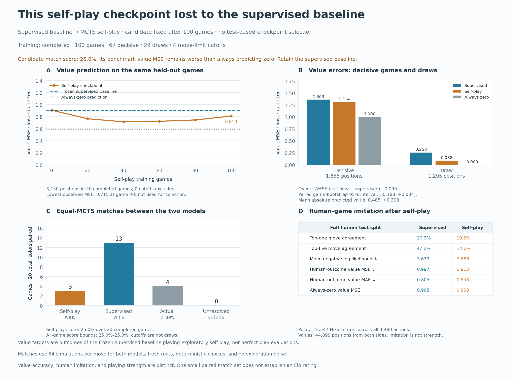

# MCTS self-play from supervised epoch 3: a regression in the direct match

We initialized MCTS self-play from the selected Hikaru epoch-3 model and completed 100 games with 800 optimizer updates. **The final self-play model played worse in the fixed comparison: 3 wins, 13 losses, and 4 draws against the supervised model.** Both sides used 64 MCTS simulations per move, with colors swapped from ten openings. All twenty games ended naturally.

Aggregate value MSE decreased on the fixed benchmark, but both models performed worse than always predicting zero. Most of the observed reduction came from drawn positions, and the paired game-level interval includes no improvement. Human move imitation also deteriorated. This pilot does not support replacing the supervised model with the game-100 checkpoint.

## Protocol and training

The [protocol](protocol.json) was recorded before generation/training. The initializer is the unchanged supervised epoch-3 checkpoint, SHA256 `b6360d2b1de42fc704813248946830394bd3eccafa0ab251fd997f627abef12a`. Its 10,030,913 parameters were loaded exactly; Adam and replay started fresh. Policy supervision changed from recorded Hikaru moves to MCTS visit distributions for both players. Value supervision used observed self-play outcomes from each side to move.

Settings were fixed at 100 games, 64 simulations per ply, temperature 1, root Dirichlet alpha 0.3/fraction 0.25, a 400-ply cap, batch size 64, eight updates per game after a 256-position warmup, replay capacity 20,000, Adam learning rate 0.0001, value-loss weight 1, seed 2, CPU, and four Torch threads. The candidate was defined in advance as the final game-100 checkpoint. No evaluation result selected a different checkpoint or changed the training settings.

The run took about **24 minutes**, including updates, probes, checkpoints, and reports. Self-play itself accounted for about 19.5 minutes. It generated **19,465 positions**: 67 games ended in checkmate, 29 were genuine draws, and four hit the move limit. All positions fit within the bounded replay buffer. There were 800 updates and 51,200 sampled examples for each head.

The existing cutoff-zero policy remained enabled. The four cutoffs contributed 1,600 generated positions (8.2%). Across sampled updates, 3,483 examples came from cutoffs, 27,813 from genuine draws, and 19,904 from decisive games. Thus 61.1% of sampled value targets were zero, mostly from genuine draws. This experiment does not isolate the effect of cutoff labeling from other training choices.

## Fixed value benchmark

Before training, we generated and froze twenty independent games from the supervised model using seed 20261107, the same 64-simulation/temperature-one exploratory self-play recipe, and a 400-ply cap. All twenty completed: fifteen checkmates and five genuine draws, with **3,150 pre-move positions**. The [freeze record](benchmark_freeze.json) and [benchmark manifest](benchmark/manifest.json) identify the exact model, settings, timestamps, and data hash. None of these game histories entered replay; common opening positions may still occur independently.

Both models see the same states, history, and side-to-move outcome targets. Targets describe observed outcomes under the frozen baseline's exploratory policy, not perfect-play values or outcomes under the candidate's new policy. Every position in every completed benchmark game is scored. Unknown cutoff outcomes would be excluded and counted explicitly; this benchmark has none.

| Value measurement | Supervised epoch 3 | Self-play game 100 | Always zero |
|---|---:|---:|---:|
| All positions: MSE | 0.9089 | **0.8097** | **0.5889** |
| All positions: MAE | 0.7652 | 0.7241 | 0.5889 |
| Decisive games: MSE | 1.3631 | 1.3139 | 1.0000 |
| Decisive games: MAE | 0.9999 | **1.0640** | 1.0000 |
| Drawn games: MSE | 0.2582 | 0.0876 | 0.0000 |
| Mean absolute prediction | 0.4849 | 0.3029 | 0.0000 |

The observed aggregate MSE reduction is about 10.9%, with roughly 71% of that reduction contributed by drawn-game positions. Predictions moved closer to zero. Decisive-position MAE worsened, and decisive-position MSE still exceeds the zero predictor. Lower overall MSE therefore does not establish a useful learned outcome advantage.

The 95% descriptive paired game-bootstrap interval for candidate-minus-baseline MSE is **[-0.1879, +0.0039]**; for MAE it is **[-0.1101, +0.0514]**. Both include zero. We resample whole games as paired clusters (2,000 replicates), retaining position-weighted metrics, rather than treating adjacent positions as independent. With only twenty fixed games, these intervals have limited scope.

The same benchmark was evaluated retrospectively across prespecified checkpoints:

| Self-play games completed | Fixed-benchmark value MSE |
|---:|---:|
| 0 | 0.9089 |
| 20 | 0.7662 |
| 40 | 0.7154 |
| 60 | 0.7235 |
| 80 | 0.7464 |
| 100 | 0.8097 |

The lowest observed error occurs at game 40, then rises, while remaining below the initial model's error. Every measured checkpoint still performs worse than the zero baseline of 0.5889. The game-100 candidate was fixed before these measurements; game 40 was not substituted after seeing the benchmark. Choosing checkpoints by this benchmark would require a separate validation/test design.

## Equal-budget playing comparison

Each of ten frozen legal openings was played twice, swapping model colors. The first six openings are the prior named two-ply openings; four more use seeded legal continuations. They are a reproducible diagnostic suite, not a representative opening-theory benchmark. Both models use fresh-tree, noiseless MCTS, 64 simulations per decision, no move sampling, and at most 400 additional plies after the opening.

| Outcome for self-play model | Games |
|---|---:|
| Wins | **3** |
| Losses to supervised model | **13** |
| Genuine draws by repetition | **4** |
| Unresolved at move limit | **0** |

The self-play model scores **5/20 (25%)**, versus 75% for the supervised model. All sixteen decisive games end in checkmate; the other four end by repetition. Since there are no cutoffs, its all-game score bounds are exactly [25%, 25%]. These are outcome bounds, not a statistical confidence interval. Equal simulations do not guarantee identical elapsed time. Twenty games from one training seed do not establish an Elo rating, but the observed comparison is a clear regression on this suite.

The fixed four tactical probes remain 2/4 with MCTS at initialization and after game 100. These tiny probes are not sufficient to predict the match result.

## Retention of the human task

We evaluated the complete original human test split after training: 22,547 Hikaru policy targets and 44,899 both-player value targets. This is a repeated held-out diagnostic, never used for this run's model selection.

| Full human-test metric | Supervised epoch 3 | Self-play game 100 |
|---|---:|---:|
| Policy NLL, all actions | **3.6393** | 3.8532 |
| Policy top-one, all actions | **20.3%** | 10.9% |
| Policy top-five, all actions | **47.2%** | 34.2% |
| Value MSE | 0.9967 | 0.9131 |
| Value MAE | **0.8055** | 0.8482 |

Always-zero value MSE on this human split is 0.9080, slightly better than the candidate. The policy metrics above use all 4,480 outputs and the full test population; they should not be directly compared with the prior 256-position legal-conditioned accuracy percentages. The policy decline is consistent with loss of the learned human move preferences during updates on self-play search targets. This run does not isolate which design choice caused the playing regression.



## Inspect and reproduce

The [fine-tuning guide](../../docs/selfplay-finetuning.md) gives the complete benchmark, training, comparison, and report commands. Actual local outputs:

- Comparison and match-board inspector: `runs/2026-11-06-hikaru-selfplay-01/selfplay_report.html`
- Training losses, game endings, probes, and traced decisions: `runs/2026-11-06-hikaru-selfplay-01/report.html`
- Frozen supervised model: `runs/2026-11-06-hikaru-supervised-02/checkpoints/best.pt`
- Fixed self-play candidate: `runs/2026-11-06-hikaru-selfplay-01/checkpoints/policy_value_net_100.pt`
- Independent benchmark: `runs/2026-11-06-hikaru-value-benchmark-01/`

To reproduce the checkpoint curve and human retention after a completed run:

```bash
.venv/bin/python experiments/2026-11-06-hikaru-selfplay-01/evaluate_diagnostics.py
```

The experiment archive retains the protocol, frozen benchmark, training histories and updates, paired value predictions, complete match histories, checkpoint curves, human retention, audit evidence, and reproducible figure code. Absolute workspace paths in JSON are normalized for portability; JSONL traces are copied unchanged. `archive.json` records original local file hashes. Weights, source snapshots, and HTML remain local under ignored `runs/`.

Independent [audit evidence](audit.json) verifies all 100 training games, twenty benchmark games, and twenty paired matches with python-chess; exact initialization and final hashes; target perspectives; all 3,150 paired value rows and aggregate metrics; bootstrap intervals; human populations; and the six curve checkpoint hashes. It confirms benchmark freezing before training, candidate selection before evaluation, no exact whole-game overlap, and preserved equal search settings. The actual report's six curves, metrics, denominators, and all twenty match replay controls pass DOM verification.

The full local suite discovers 158 tests (five optional Node checks skip in the shell and their controls were exercised separately). GitHub core and neural checks pass. New coverage includes exact checkpoint initialization with a fresh optimizer, benchmark integrity/outcomes, equal-budget model pairing, target perspective, unknown-outcome exclusion, metric aggregation, output protection, and report safety/controls.
