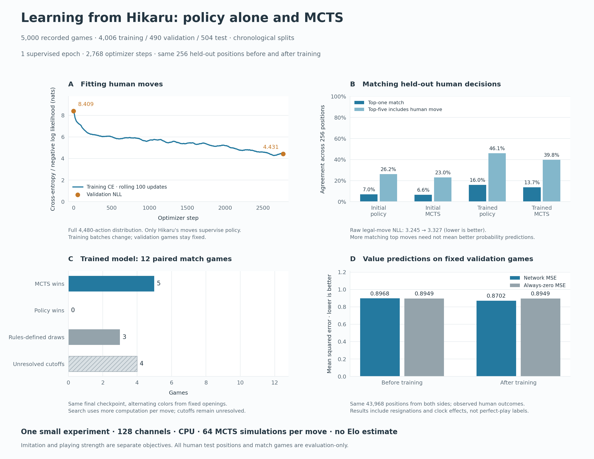

# Hikaru blitz pretraining and MCTS — November 6, 2026

We downloaded **5,000 completed, rated standard blitz games** from Chess.com's verified `Hikaru` account, trained the existing network for one epoch, and compared the same trained checkpoint with and without MCTS. Pretraining improved first-choice imitation on the held-out sample. MCTS won five diagnostic games against the raw policy and lost none, but matched Hikaru's recorded moves less often. Four matches remained unfinished. This is evidence about one small experiment, not an Elo estimate or a claim to reproduce grandmaster strength.

## Data and training

The newest eligible games span **August 7, 2025 to November 6, 2026**. The API profile identifies Hikaru Nakamura, title GM, player ID 15448422. All 5,000 PGNs passed parsing and complete move validation; no games were rejected. Hikaru scored 4,262 wins, 344 draws, and 394 losses. The selection includes resignation and clock endings, not only checkmates or wins.

| Split | UTC date range | Games | All positions / value examples | Hikaru policy examples |
|---|---|---:|---:|---:|
| Training | 2025-08-07 to 2026-07-25 | 4,006 | 352,305 | 176,913 |
| Validation | 2026-07-26 to 2026-09-15 | 490 | 43,968 | 22,076 |
| Test | 2026-09-16 to 2026-11-06 | 504 | 44,899 | 22,547 |
| Total | | 5,000 | 441,172 | 221,536 |

Whole games and UTC dates stay in one split. Exact game IDs/fingerprints are deduplicated. Common opening positions can occur in separate games, so this is not a position-disjoint test. The 56 compressed array shards occupy about 9.18 MiB; full raw PGNs and cached monthly responses remain local.

The model has 128 convolution channels and 10,030,913 parameters, freshly initialized with seed 1. Training uses CPU/four Torch threads, batch size 128, Adam at 0.001, and equal weights for policy cross-entropy and value MSE. One pass over the training set produced **2,768 updates**, using every training position once for value and every Hikaru turn once for policy. The epoch, including final validation/checkpointing, took about **350 seconds** on the local Apple M4. This is a small supervised run; no self-play updates were added.

Opponent moves reconstruct histories and contribute outcome examples, but never become Hikaru imitation targets. Outcome values are signed for the side to move. They describe recorded human results, including future errors and clock effects, rather than perfect-play board evaluations. Both sides are used for value training to avoid simply learning Hikaru's high win rate.

## Results

The same seeded sample of **256 Hikaru decisions from 199 test games** was used before and after training. Every raw/MCTS comparison uses identical positions and weights. Raw policy selects the highest-probability legal move; MCTS uses 64 simulations, no root noise or move sampling, and a fresh tree at each position.

| Held-out move agreement | Initial raw policy | Initial MCTS | Trained raw policy | Trained MCTS |
|---|---:|---:|---:|---:|
| Exact recorded move | 18/256 (7.0%) | 17/256 (6.6%) | **41/256 (16.0%)** | 35/256 (13.7%) |
| Recorded move among top five | 67/256 (26.2%) | 59/256 (23.0%) | **118/256 (46.1%)** | 102/256 (39.8%) |

MCTS changed the trained raw policy's first choice on 100/256 positions (39.1%). Agreement with the human is an imitation measure: a different move can be better or worse chess. The small sample and correlated positions from shared games limit conclusions about the size of the difference.

The raw policy's legal-conditioned negative log likelihood **worsened from 3.2446 to 3.3265 nats**, despite better top-one/top-five accuracy. It found the recorded move more often among its leading choices, but its overall probability assignment did not improve on this sample. Calibration itself was not measured. The much larger decrease in training/validation cross-entropy uses all 4,480 outputs, including illegal actions, and is not the same measurement as this legal-conditioned test NLL.

On the full validation set, policy cross-entropy fell from 8.4090 to 4.4313, and full-action top-one accuracy rose from 0.009% to 14.47%. Value MSE went from 0.8968 to 0.8702, compared with 0.8949 for always predicting zero. On the smaller Hikaru-only test sample, final value MSE was 0.9009 versus 0.9023 for zero. These results show only a modest value-prediction advantage over that simple baseline, despite a much lower average training MSE of 0.5793.

### Playing with and without search

Six fixed two-ply openings each generated two games, swapping which color used MCTS. Both players used the same trained checkpoint. A game could continue for at most 160 additional plies after its opening.

| Outcome | Games |
|---|---:|
| MCTS wins | **5** |
| Raw-policy wins | **0** |
| Genuine draws by repetition | **3** |
| Unfinished at move limit | **4** |

MCTS scored 6.5/8 among games that actually ended. The four cutoffs are unresolved and are excluded from that denominator; they are not draws. All five decisive games ended in checkmate. On the separate four tactical probes, the trained raw policy solved 0/4 and MCTS solved 2/4.

The final position evaluation averaged about 1.3 ms per raw decision versus 54 ms with MCTS. Search therefore used substantially more computation; these are not equal-time games. Timing is observational on a shared machine. The initial-checkpoint evaluation overlapped training, so its latency should not be compared with the final checkpoint's latency.



These matches suggest search helps this checkpoint relative to its own raw policy. We did not run a trained-versus-untrained strength match, so they do not isolate the effect of human pretraining on playing strength. Longer supervised training, broader training opponents/players, and stronger value supervision remain possible next experiments; none was selected by repeatedly tuning against this test sample.

## Inspect and reproduce

The [human-training guide](../../docs/human-training.md) gives the complete downloader, preparation, training, resume, and evaluation commands. Actual local paths:

- Download/cache: `data/hikaru-blitz-5000/`
- Prepared shards and full move histories: `data/hikaru-blitz-5000/prepared/`
- Training, checkpoints, evaluations, and interactive report: `runs/2026-11-06-hikaru-supervised-01/`
- Selected model: `runs/2026-11-06-hikaru-supervised-01/checkpoints/best.pt`
- Full epoch checkpoint including Adam/RNG state: `runs/2026-11-06-hikaru-supervised-01/checkpoints/epoch_1.pt`

Training used one epoch, batch 128, hidden 128, learning rate 0.001, value weight 1, seed 1, CPU, and four threads. Both evaluations used test split, 256 positions, seed 1, 64 simulations, and four threads. The initial evaluation used zero match pairs; the final evaluation used six pairs and a 160-ply additional cap. The final checkpoint was selected using validation before reading the test results.

`report.html` is a self-contained local inspector: learning curves, split counts, raw/search comparison, match endings, and a board viewer showing the recorded Hikaru move alongside the two engine choices. Rebuild with:

```bash
python3 chess/scr/human_report.py --run-dir runs/2026-11-06-hikaru-supervised-01
```

This tracked directory preserves portable download/dataset manifests, all optimizer and validation measurements, both evaluations' per-position choices, every diagnostic match history, and figure code. Raw PGNs, cached source archives, prepared arrays, source snapshots, HTML reports, and model weights stay local under ignored `data/` and `runs/`. The recorded source hashes identify the exact training code even though the run began before its Git commit.

Independent audits verified source-cache correspondence for all 5,000 games, all 441,172 stored move indices and policy/value labels, sampled input planes against python-chess, disjoint split dates, and all shard hashes. Evaluation audits replayed 12,867 historical moves to verify the 256 test positions and their candidate moves, plus all 1,542 match moves including openings and every ending classification. Initial/final sample identities and model hashes match. Tests also verify that CPU epoch-boundary resume produces identical weights to uninterrupted training.
