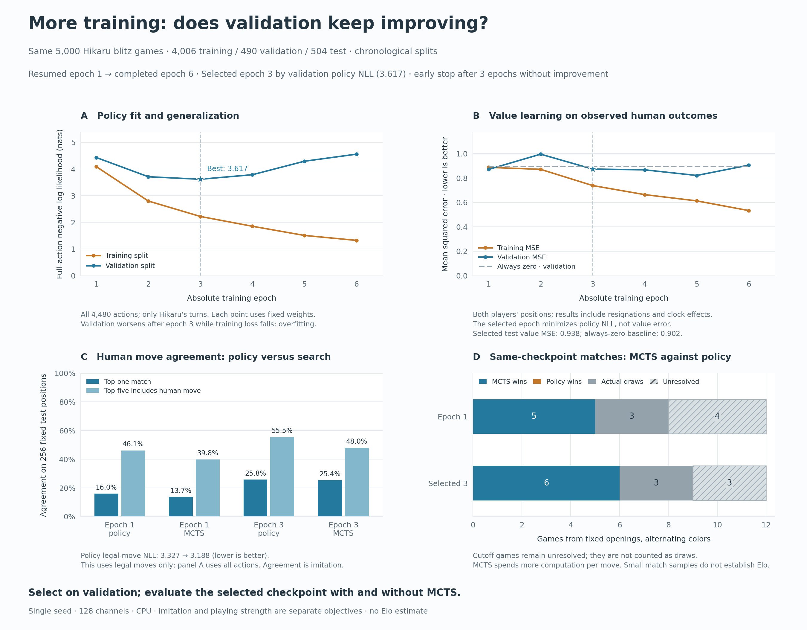

# More Hikaru training: validation peaks at epoch 3

We continued the same 5,000-game experiment from its saved epoch-1 optimizer checkpoint. Validation policy loss improved through **epoch 3**, then worsened for three consecutive epochs while training loss kept falling. Early stopping ended the run after **epoch 6**. The selected epoch-3 model improved held-out move agreement and won six diagnostic games with MCTS against its own raw policy, with no losses, three draws, and three unresolved cutoffs.

## Fixed experiment design

The dataset and chronological splits are unchanged: 4,006 training games, 490 validation games, and 504 test games. The prepared dataset manifest SHA256 is `cd796ee9ce0a541d07565c0bcccd27c2c91ef01aea88d26231ba0dbe7636829e`. Training still supervises policy only on Hikaru's 176,913 training decisions and value on all 352,305 training positions. No additional games or test examples were used for optimization.

The [recorded protocol](protocol.json) allowed nine additional epochs (ten total), with unchanged 128-channel architecture, batch size 128, Adam learning rate 0.001, equal policy/value loss weights, seed 1, CPU, and four Torch threads. Optimizer and RNG state resumed from the first run. Patience was three epochs, with minimum delta zero. **Minimum full-validation policy NLL** selected the checkpoint, including the starting model as a candidate. Test scores and match outcomes did not affect stopping or selection.

We completed five additional epochs, 13,840 new optimizer steps (16,608 total), in about **35 minutes**, including the epoch-end measurements and checkpointing. Including the initial baseline measurements, elapsed time was about 36 minutes. Each completed epoch includes a frozen-weight evaluation over all training and validation positions, so their losses are directly comparable. These measurements differ from the average pre-update batch loss logged during training.

New checkpoints preserve the best weights, Adam/RNG state, and early-stopping state across future resumptions. The epoch-1 legacy checkpoint has no embedded historical best, so its weights initialized the best candidate. Exact equality with the earlier selected model was verified before reusing its evaluation.

## Validation and overfitting

Policy loss is negative log likelihood (NLL); lower is better. These metrics use all 4,480 outputs and Hikaru turns only. Value MSE uses both players' positions.

| Total epoch | Train policy NLL | Validation policy NLL | Train top-one | Validation top-one | Validation value MSE |
|---|---:|---:|---:|---:|---:|
| 1 | 4.089 | 4.431 | 16.4% | 14.5% | 0.870 |
| 2 | 2.800 | 3.711 | 29.0% | 19.8% | 0.995 |
| 3 **(selected)** | 2.221 | 3.617 | 40.1% | 21.4% | 0.873 |
| 4 | 1.854 | 3.787 | 48.2% | 22.1% | 0.867 |
| 5 | 1.510 | 4.293 | 56.2% | 22.4% | 0.821 |
| 6 | 1.324 | 4.557 | 60.7% | 22.7% | 0.905 |

Epochs 4–6 show an overfitting pattern: the training loss decreases from 2.221 at the selected checkpoint to 1.324, while validation loss increases from 3.617 to 4.557. The NLL gap grows from 0.342 at epoch 1 to 3.233 at epoch 6. The run stops after three consecutive epochs without a new minimum.

Validation top-one accuracy continues to increase slightly even as NLL worsens. Accuracy measures whether the leading move is correct; NLL also penalizes low probability assigned to recorded moves. Thus a higher hit rate does not guarantee better probability assignment. Calibration itself was not measured. The checkpoint criterion was fixed in advance; we did not switch to accuracy after inspecting the results.

The value head behaves differently. Its best validation MSE occurs at epoch 5 (0.821), whereas the selected policy checkpoint at epoch 3 has MSE 0.873. Always predicting zero gives 0.895 on validation. The selected checkpoint is the best by policy NLL, not by value error or demonstrated playing strength. Epoch 6 has training value MSE 0.533 and validation MSE 0.905, showing that the final training fit also fails to carry over for value.

## Selected model with and without MCTS

The selected weights were verified against `epoch_3.pt`, and [selection.json](selection.json) records their hash and the validation-history hash before the new test evaluation started. The same 256 target-player decisions from 199 test games are used as before. This is a repeated diagnostic sample, not a fresh untouched benchmark. All test games remain outside optimization.

| Held-out agreement | Epoch 1 raw | Epoch 1 MCTS | Selected epoch 3 raw | Selected epoch 3 MCTS |
|---|---:|---:|---:|---:|
| Exact recorded move | 41/256 (16.0%) | 35/256 (13.7%) | **66/256 (25.8%)** | **65/256 (25.4%)** |
| Recorded move among top five | 118/256 (46.1%) | 102/256 (39.8%) | **142/256 (55.5%)** | 123/256 (48.0%) |

Raw legal-conditioned NLL improved from **3.3265 to 3.1880**. This is a different denominator from the full-action validation NLL above. MCTS changes the raw policy's move on 63/256 positions (24.6%). The difference of one exact match between the two modes is too small to support a general claim that either imitates Hikaru better. Positions within games are correlated, and common openings can appear in multiple splits.

Value error on this Hikaru-only sample worsened from **0.9009 to 0.9380**, compared with **0.9023** for always predicting zero. Better move imitation has not produced a reliable outcome evaluator. Human game results include clock effects and later mistakes; these are not minimax value targets.

MCTS uses 64 simulations, no root noise, no move sampling, and a fresh tree. Six fixed two-ply openings each yield two games with colors swapped; the cap is 160 additional plies after the opening.

| Outcome | Epoch 1 comparison | Selected epoch 3 comparison |
|---|---:|---:|
| MCTS wins | 5 | **6** |
| Raw-policy wins | 0 | **0** |
| Genuine draws by repetition | 3 | **3** |
| Unfinished at move limit | 4 | **3** |

All six decisive games end in checkmate. MCTS scores 7.5/9 (83.3%) among completed games; the three cutoffs are unresolved and excluded. Tactical probes remain 0/4 for raw policy and 2/4 with MCTS. Mean decision times in the final position evaluation are about 1.4 ms raw and 60.5 ms with search. MCTS receives more computation, so this is not an equal-time match or an Elo estimate.

These matches compare each checkpoint's search against its own raw policy. They do not directly test epoch 3 against epoch 1 for playing strength. The evidence supports improved imitation and a benefit from search in this small match set, alongside clear policy overfitting beyond epoch 3.



## Inspect and reproduce

The [training guide](../../docs/human-training.md#follow-validation-across-more-epochs) contains the continuation command. Actual outputs remain local:

- Interactive report and all logs: `runs/2026-11-06-hikaru-supervised-02/report.html`
- Selected policy checkpoint: `runs/2026-11-06-hikaru-supervised-02/checkpoints/best.pt` (epoch 3)
- Full optimizer checkpoint for that model: `runs/2026-11-06-hikaru-supervised-02/checkpoints/epoch_3.pt`
- Last model: `runs/2026-11-06-hikaru-supervised-02/checkpoints/final.pt` (epoch 6; not the selected model)

The report shows all six frozen-checkpoint measurements, the train/validation gap, selected epoch and stop reason, per-update losses, the repeated test comparison, match ending counts, and an interactive position board. Rebuild it with:

```bash
python3 chess/scr/human_report.py --run-dir runs/2026-11-06-hikaru-supervised-02
```

To repeat the selected model's evaluation into a fresh directory:

```bash
PYTHONPATH=chess .venv/bin/python -u -m scr.evaluate_human \
  runs/2026-11-06-hikaru-supervised-02/checkpoints/best.pt \
  data/hikaru-blitz-5000/prepared runs/hikaru-epoch3-evaluation-repeat \
  --max-positions 256 --sims 64 --seed 1 --threads 4 \
  --match-pairs 6 --max-plies 160
```

`eval-initial` reuses the earlier epoch-1 evaluation byte for byte; its `reuse.json` records model equality and original file hashes. The new evaluation uses the selected epoch-3 weights. This archive normalizes absolute workspace paths in JSON for portability; JSONL traces are unchanged. `archive.json` records hashes of the original local files. Model weights, raw data, source snapshots, and HTML remain in ignored local directories.

The full local suite discovers 134 tests, with three optional Node checks skipped by the shell environment; their report DOM harnesses were exercised separately. GitHub's core and neural checks pass. Added tests cover patience, strict best-model selection independent of minimum delta, preserved best/patience state across resume, legacy checkpoints, frozen full-training evaluation, and report compatibility.

Independent [audit evidence](audit.json) verifies the unchanged data and all shard/source hashes, exact counts for the 13,840 new updates, best epoch-3 and final epoch-6 weights, and selection before test evaluation. The audit reconstructs all 44,899 test plies with python-chess and independently reproduces the same 256-position reservoir. All candidate moves, result metrics, and twelve complete match histories and ending classifications agree. The actual final report also passes DOM checks for all epoch curves, checkpoint selection, board controls, and the nine-completed/three-unfinished match denominator.
