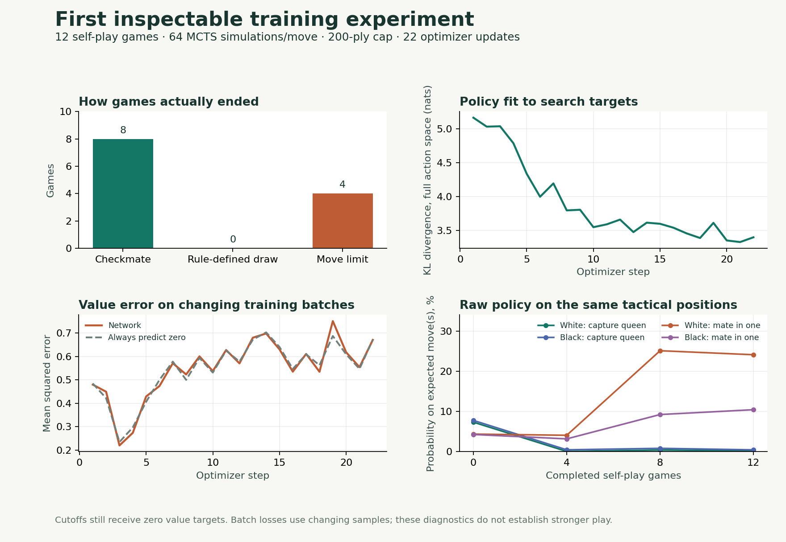

# First inspectable training experiment — November 6, 2026

This pilot tests whether the new logs reveal how self-play creates targets and how the network changes. It is not a playing-strength evaluation.

## Setup

Randomly initialized 128-channel network (10,030,913 parameters), seed 1, CPU with four Torch threads, 12 self-play games, 64 MCTS simulations per move, and a 200-ply cap. Temperature stays at 1, root Dirichlet noise mixes 25% with alpha 0.3, and Adam uses learning rate 0.001. Warmup is shortened to 256 positions; each later game produces two updates with batch size 64. Fixed probes use 80 simulations with no exploration noise and run at games 0, 4, 8, and 12. Every game has a full local move trace.

Reproduce with a new run directory:

```bash
.venv/bin/python chess/scr/main.py \
  --iterations 12 --sims 64 --max-moves 200 --hidden 128 \
  --batch-size 64 --min-buffer 256 --updates 2 --seed 1 --device cpu --threads 4 \
  --run-dir runs/inspection-reproduction --trace-every 1 \
  --probe-every 4 --probe-sims 80 --save-every 4 --report-every 1
```

## What happened

| Measurement | Result |
|---|---:|
| Games reaching checkmate | 8 / 12 |
| Genuine draws | 0 / 12 |
| Games cut off at 200 plies | 4 / 12 (33.3%) |
| Generated positions | 1,874 |
| Positions receiving zero labels solely because of a cutoff | 800 / 1,874 (42.7%) |
| Optimizer updates | 22 |
| Self-play time, excluding updates/probes/checkpoint/report IO | 99.4 seconds |
| Total run time | About 149 seconds |

The replay buffer never reached capacity, so all 1,874 positions remained available at the end. Of these, 1,074 came from decisive games. All zero labels in this pilot came from unfinished games: no rules-defined draws occurred.



Policy cross-entropy fell from 8.404 to 6.610, and policy KL from 5.162 to 3.402 nats between the first and last sampled batches. This indicates closer fit to the generated search targets on those batches. The batches differ, so these are not a fixed validation-loss comparison. Value MSE went from 0.480 to 0.671; the last batch also contained more decisive labels (67.2% versus 48.4%). That change alone cannot diagnose value regression.

Across all 22 sampled batches, mean network value MSE was **0.5473**, compared with **0.5455** for always predicting zero on those same batches. This pilot therefore establishes no useful value-prediction advantage over that trivial baseline. Of the 1,408 samples actually used by the optimizer, 640 (45.5%) came from cutoff positions; 372 had winning labels and 396 had losing labels.

The fixed inputs tell a more specific story:

| Probe | Raw policy probability on expected move(s), before → after | MCTS result, before → after |
|---|---:|---|
| White mate in one | 4.37% → 24.09% | Pass → Pass |
| Black mate in one | 4.27% → 10.43% | Pass → Pass |
| White captures hanging queen | 7.33% → 0.21% | Miss → Miss |
| Black captures hanging queen | 7.77% → 0.45% | Pass → Miss |

The network's preferences changed unevenly: probability increased on both mating moves but decreased sharply on both queen captures. Search solved two of four tactical probes after training, versus three of four before. It continued to find the immediate mates even when the raw policy did not rank one first. The final raw values for White/Black mate-in-one were only +0.094 and -0.046, while the kings-only drawn position was valued +0.094. This run does not show reliable position-value understanding or establish improved playing strength.

## Inspect the evidence

The full local run is `runs/2026-11-06-inspection-01/`. Its `report.html` includes a move slider, board positions, raw policy/search comparisons, optimizer curves, and fixed probes. Initial/game-4/game-8/final checkpoints and the exact source snapshot are saved there; weights and full traces are excluded from Git.

This directory retains portable configuration/summary files, every optimizer/probe record, and all game move histories/endings. `games.jsonl` deliberately omits detailed per-ply traces to keep the tracked example small. `plot.py` regenerates the PNG/SVG with Matplotlib (3.10.8 used here); it is optional and not a runtime dependency of the engine/report.

All 1,874 recorded moves and final ending classifications were independently checked against python-chess. The automated suite verifies termination precedence, cutoff provenance, finite metrics, unchanged optimizer calculations, preserved probe random state, and robust report loading. Report JavaScript controls were checked with a DOM test double; local-file browser preview was blocked by the browser tool's URL policy.

## What to investigate next

Keep real draws and cutoff labels separate in every experiment. A matched comparison of the current zero-label policy with a carefully chosen truncation strategy would help isolate its effect. More diverse training data and a fixed evaluation set are also needed before drawing conclusions from loss curves. Do not infer strength gains from these 12 self-play outcomes or four tactical checks.
